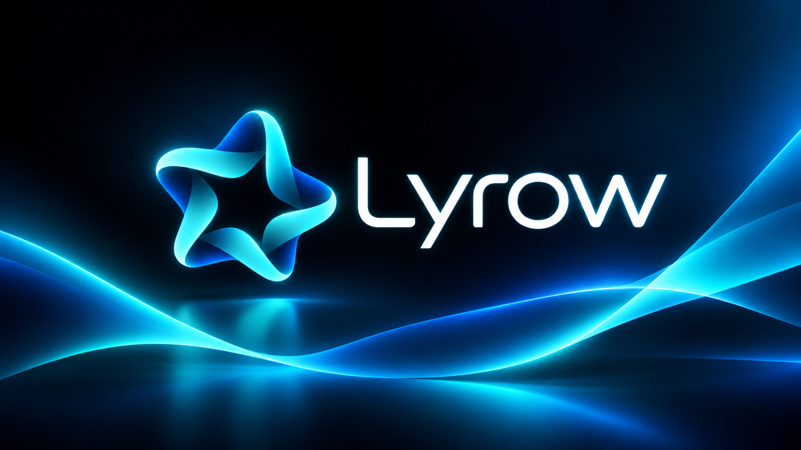

<p align="center">
  
</p>

# Lyrow

> A native Windows music companion with synchronized lyrics, playback controls, and a compact desktop experience.

[](https://github.com/owergungor/Lyrow/actions/workflows/release.yml)
[](https://microsoft.com/windows)
[](https://dotnet.microsoft.com/)
[](https://learn.microsoft.com/windows/apps/winui/winui3/)
[](https://github.com/owergungor/Lyrow/releases)
[](https://github.com/owergungor/Lyrow/actions)
[](LICENSE)

**Lyrow**, Windows 10 ve 11 için geliştirilmiş, müzik dinleme deneyimini görsel bir atmosfere dönüştüren yerel bir masaüstü uygulamasıdır. **WinUI 3 ve Windows App SDK** mimarisi üzerinde çalışan Lyrow; doğrudan birincil pencere olarak açılan senkronize şarkı sözleri arayüzü, albüm kapağına göre otomatik renk değiştiren 4 kenarlı Kenar Işığı (Edge Light), tüm modlarda tıklamayla açılan ortak **Parlaklık (`10–100%`) ve Kalınlık (`0–64 px`)** kontrol paneli, 7 sekmeli sabit boyutlu Microsoft Windows 11 Fluent Design ayarlar modalı, hem Normal/Tam Ekran hem Dar Modda ikon-odaklı ses çıkışı ve Ghost Button kontrolleri, 2×/0.5× akıcı pencere genişliği geçişi ve kompakt Dar Mod (Mini Player) sunar.

---

## 📥 İndirme ve Kurulum

### Güncel Sürüm: Lyrow v4.7 (Yerel Paketler Hazır — Setup EXE, Portable ZIP & MSIX)

| Kaynak | Dosya | Boyut | SHA-256 Doğrulama Özeti |
|---|---|---|---|
| **Kurulum Sihirbazı (Installer)** | `Lyrow-4.7-Setup-x64.exe` | 64.54 MB | `F84492D086449B77BD040C7BAF24A1E13DB1AF652BC9E4F56B5CFC114217F16A` |
| **Taşınabilir Paket (Portable ZIP)** | `Lyrow-v4.7-win-x64-portable.zip` | 92.74 MB | `10FB9EA911437D959E3EEA71803AF03F80B6A08E8168741160764E5B4005E944` |
| **MSIX Paketi (Windows x64 — Store Kimlikli)** | `Lyrow-v4.7-x64.msix` *(imzasız)* | 94.80 MB | `6C0184A83460244727274BC22E3F8F8C26AF020518E73049CEEBC9C141A177A2` |

> [!NOTE]
> Lyrow bağımsız (self-contained) bir Windows x64 paketidir. Çalışmak için harici bir .NET Runtime veya Windows App SDK kurulumu gerektirmez. Kurulum sihirbazını çalıştırabilir veya taşınabilir arşivi bir klasöre çıkartıp `Lyrow.App.exe` dosyasını doğrudan çalıştırabilirsiniz. MSIX paketi (`Lyrow-v4.7-x64.msix`) Microsoft Partner Center kimliğiyle (`crius.Lyrow` / `crius`) **imzasız** olarak üretilir; Microsoft Store yüklemesinde Store imzası uygulanır, yerel yan yükleme için güvenilen bir kod imzalama sertifikasıyla imzalanması gerekir.

### Yayınlanmış Kararlı Sürümler (v4.6, v4.5, v4.4, v4.3, v4.2, v4.1, v4.0, v3.8, v3.7 & v3.5)
GitHub Releases üzerinde yayında olan sürümler:
- **v4.6 Sürümü (Setup EXE, Portable ZIP, MSIX):** [Lyrow v4.6](https://github.com/owergungor/Lyrow/releases/tag/v4.6)
- **v4.5 Sürümü (Setup EXE, Portable ZIP, MSIX):** [Lyrow v4.5](https://github.com/owergungor/Lyrow/releases/tag/v4.5)
- **v4.4 Sürümü (Setup EXE, Portable ZIP, MSIX):** [Lyrow v4.4](https://github.com/owergungor/Lyrow/releases/tag/v4.4)
- **v4.3 Sürümü (Setup EXE, Portable ZIP, MSIX):** [Lyrow v4.3](https://github.com/owergungor/Lyrow/releases/tag/v4.3)
- **v4.2 Sürümü (Setup EXE, Portable ZIP, MSIX):** [Lyrow v4.2](https://github.com/owergungor/Lyrow/releases/tag/v4.2)
- **v4.1 Sürümü (Setup EXE, Portable ZIP, MSIX):** [Lyrow v4.1](https://github.com/owergungor/Lyrow/releases/tag/v4.1)
- **v4.0 Kurulum Sihirbazı & Taşınabilir Paket:** [Lyrow v4.0](https://github.com/owergungor/Lyrow/releases/tag/v4.0)
- **v3.8 Kurulum Sihirbazı & Taşınabilir Paket:** [Lyrow v3.8](https://github.com/owergungor/Lyrow/releases/tag/v3.8)
- **v3.7 Taşınabilir Paket:** [Lyrow v3.7](https://github.com/owergungor/Lyrow/releases/tag/v3.7)
- **v3.5 Kurulum Sihirbazı & Taşınabilir Arşiv (Lyrow v3.5):** [Lyrow-3.5-Setup-x64.exe](https://github.com/owergungor/Lyrow/releases/tag/v3.5) · [Lyrow-v3.5-win-x64-portable.zip](https://github.com/owergungor/Lyrow/releases/tag/v3.5)

---

## 🌟 Mimari ve Temel Modüller

Lyrow, iki bağımsız ancak birbiriyle tam senkron çalışan ana modülden oluşur:

```
┌────────────────────────────────────────────────────────┐
│                        Lyrow                           │
│  ┌──────────────────────────┐┌──────────────────────┐  │
│  │   Ambient Glow Modülü    ││ Lyrics & Mini Player │  │
│  │ - 4 Kenar Ekran Işıması  ││ - Senkronize Sözler  │  │
│  │ - WASAPI Loopback Capture││ - GSMTC Entegrasyonu │  │
│  │ - 5 Bant FFT Spektrumu   ││ - Dar Mod (352x148)  │  │
│  └─────────────┬────────────┘└──────────┬───────────┘  │
│                │                        │              │
│                ▼                        ▼              │
│  ┌──────────────────────────────────────────────────┐  │
│  │   Merkezi Playback Timeline Motoru (Lyrow.Core)  │  │
│  │   - İzole Parça Süresi, Geçen ve Kalan Zaman     │  │
│  └──────────────────────────────────────────────────┘  │
└────────────────────────────────────────────────────────┘
```

1. **Ambient Edge Glow (Ortam Aydınlatması):**
   Ekranın 4 kenarında (Üst, Alt, Sol, Sağ) sistem ses çıkışının ritmine, 5 frekans bandına (Sub-Bass, Bass, Low-Mid, Mid, High-Mid/Treble) ve Spectral Flux vuruş algılamasına göre bağımsız renk enerjisi yayar. Albüm kapağının renk paletiyle yumuşak cross-fade geçişleri yapar ve diğer pencerelerin kullanımını **kesinlikle engellemez (click-through, zero-interference)**.

2. **Lyrics & Compact Player (Şarkı Sözleri ve Mini Oynatıcı):**
   Windows GSMTC üzerinden çalan medyayı otomatik algılar, LRCLIB API aracılığıyla senkronize şarkı sözlerini milisaniye hassasiyetinde çeker, aktif satırı dikey olarak odaklar ve soldan sağa akıcı **karaoke dolum animasyonu (word/character fill)** sunar.

---

## 🚀 Temel Yetenekler

### 1. Zaman Çizelgesi ve Süre Doğruluğu
- **Merkezi Playback Timeline Motoru (`IPlaybackTimelineEngine`):** Geçen süre (`0:45`) ve kalan süre (`-2:15`) her parça için bağımsız hesaplanır; önceki şarkıların süreleri kesinlikle birbirine eklenmez.
- **Otomatik Parça Geçiş İzolasyonu (`A → B → C`):** Şarkı bittiğinde veya atlandığında zaman çizelgesi, sözler ve albüm kapağı atomik olarak sıfırlanır; eski parçanın GSMTC kalıntıları yeni parçanın zaman çizelgesini bozamaz.
- **Deterministik İlerleme (Seek):** İlerleme çubuğunda tıklanan veya sürüklenen noktaya ya da şarkı sözü satırına tıklandığında anında deterministik atlama yapılır.

### 2. Arayüz ve Görünüm Modları
- **Normal Mod & Tam Ekran Mod (`F11`):** 50/50 yatay düzen (solda yüksek çözünürlüklü albüm kapağı ve Ghost Button oynatma kontrolleri, sağda dikey merkezlenen akıcı şarkı sözleri). Şarkı sözleri gizlendiğinde pencere genişliği akıcı biçimde yarıya iner (`0.5×`), tekrar açıldığında iki katına çıkar (`2×`).
- **Dar Mod (Compact Player):** Masaüstünde minimum alan kaplayan yatay düzen: albüm kapağı, parça bilgisi, ilerleme çubuğu, açılır 3 satırlık şarkı sözü çekmecesi, tüm kontroller için tutarlı Ghost Button tasarımı, kayan ses kontrolü, ikon-odaklı ses çıkışı seçicisi ve Normal Modla birebir aynı Kenar Işığı paneli.
- **Kenar Işığı (Edge Light) — Parlaklık & Kalınlık Paneli:** Hem Normal/Tam Ekran Modda hem Dar Modda Kenar Işığı butonuna tıklandığında açılan ortak panelde üstte **Parlaklık (`10–100%`)**, altta **Kalınlık (`0–64 px`)** sürgüleri bulunur. `0 px` Kenar Işığını tamamen kapatır; değişiklikler anında uygulanır, tüm modlar ve Ayarlar sayfasıyla senkronize kalır.
- **Windows 11 Fluent Design Ayarlar Modalı:** Sabit boyutlu (`740×520`), sola hizalı 7 sekmeli (**Genel**, **Görünüm**, **Işık**, **Şarkı Sözleri**, **Sistem**, **Güncellemeler**, **Hakkında**) modern ayarlar arayüzü; Açık/Koyu/Sistem teması ve Türkçe/İngilizce dil desteği.
- **Yüksek Çözünürlüklü & Animasyonlu Kapaklar:** Kapak görselleri ham kalitesinde korunur; animasyonlu GIF ve WebP kapakları donanım hızlandırmalı oynatılır.

### 3. Sistem, Ses ve Otomatik Güncelleme Entegrasyonu
- **İkon-Odaklı Ses Çıkış Aygıtı Seçimi:** Normal ve Tam Ekran Modda alt araç çubuğunda Kenar Işığı butonunun hemen sağında (`28×28`), Dar Modda ise Volume & Mute butonunun yanında (`26×26`) konumlanan ikon-odaklı ses çıkışı butonu ile Windows ses yürütme cihazı (Kulaklık, Hoparlör, Bluetooth) anında değiştirilir; aktif cihaz bilgisi Tooltip üzerinde gösterilir ve tüm modlarda senkronize çalışır.
- **Kayan Ses Düzeyi Popup'ı:** Dar modda ses simgesine tıklandığında açılan, sessize alma (mute) butonlu yatay ses kaydırıcısı.
- **Sağ Üst Windows 11 Fluent Güncelleme Toast Bildirimi:** Yeni sürüm tespit edildiğinde Normal, Tam Ekran ve Dar modların tamamında ekranın sağ üst köşesinde Açık/Koyu tema uyumlu, `ThemeShadow` gölgeli bir toast bildirimi görünür. **Şimdi Kur** butonu indirme, PE + SHA-256 doğrulama ve güvenli yeniden başlatma akışını başlatır; **Sonra** butonu bildirimi aynı oturumda kapatır ancak güncelleme bilgisini silmeden **Ayarlar > Güncellemeler** bölümünde hazır tutar.
- **Ayarlar > Güncellemeler (**Yeni Sürümü Kur**):** Manuel veya zamanlanmış denetimlerde yeni sürüm numarası, yayın tarihi, kısa sürüm açıklaması, belirgin **Yeni Sürümü Kur** butonu, canlı indirme/kurulum ilerlemesi ve hata durumunda yeniden deneme sunulur; MSIX ve Portable dağıtımları için güvenli yönlendirme sağlanır.

---

## 🎵 Desteklenen Medya Platformları

Lyrow, Windows'un yerel **Global System Media Transport Controls (GSMTC)** API'sini dinler. Aşağıdaki platformlar kod tabanında ve test senaryolarıyla doğrulanmıştır:

| Platform | Ortam | Doğrulanan Yetenekler |
|---|---|---|
| **Spotify Desktop** | Masaüstü İstemcisi | Şarkı Bilgisi, Albüm Kapağı, Oynat/Duraklat, Önceki/Sonraki, Seek, Söz Senkronizasyonu |
| **Apple Music Desktop** | Windows 11 Uygulaması | Şarkı Bilgisi, Sanatçı/Albüm Ayrıştırması, Kapak, Oynatma Kontrolleri |
| **Apple Music Web** | Edge, Chrome, Firefox | Şarkı Bilgisi, Web Kapak Çözümlemesi, Seek, Tarayıcı Yönlendirmesi |
| **YouTube Music Web** | Edge, Chrome, Firefox | Şarkı Bilgisi, Otomatik Parça Geçişi, Kapak Çözümlemesi, Oynatma Kontrolleri |
| **Windows Media Player / Diğerleri** | Masaüstü / UWP / PWA | Windows GSMTC arayüzünü destekleyen tüm modern medya oynatıcıları |

---

## ⏱️ Playback Timeline Mekanizması

Lyrow v3.7 ile baştan yazılan **Playback Timeline Engine**, müzik çalarlardaki zamanlama hatalarını kökten çözer:

```
[Parça A (3:30)] ─── 0:00 ───────> 3:30 ─── Otomatik Geçiş ───>
[Parça B (3:11)] ─── 0:00 (Yeni) ─> 1:01 [Kalan: -2:10] (Kümülatif toplam: YOK)
```

- **İzole Geçen Süre (Elapsed Time):** Yalnızca o an çalan parçanın başlangıçtan itibaren geçen süresi hesaplanır (`1:01`).
- **İzole Kalan Süre (Remaining Time):** Her zaman `Parça Süresi - Geçen Süre` formülüyle negatif formatta hesaplanır (`-2:10`).
- **Enterpolasyon Dengelemesi:** Milisaniye düzeyindeki zaman çizelgesi kaymaları yuvarlanarak süre sayacında titreme (jitter) ve sekme (snap-back) önlenir.

---

## 💻 Sistem Gereksinimleri

| Bileşen | Asgari Gereksinim | Önerilen Donanım |
|---|---|---|
| **İşletim Sistemi** | Windows 10 64-bit (Sürüm 2004 / Derleme 19041+) | **Windows 11 64-bit (22H2 veya 24H2)** |
| **İşlemci (CPU)** | 64-bit çift çekirdekli Intel / AMD işlemci | Intel Core i3 / AMD Ryzen 3 veya üstü |
| **Bellek (RAM)** | 4 GB RAM | 8 GB RAM |
| **Grafik Kartı (GPU)** | DirectX 11 / DWM destekli grafik kartı | Donanım hızlandırmalı modern GPU |
| **Ses Aygıtı** | Standart Windows ses çıkışı (WASAPI Loopback uyumlu) | Kulaklık, Hoparlör veya Bluetooth Ses Cihazı |
| **Çalışma Zamanı** | Bağımsız pakette **harici runtime gerekmez** | Geliştirme için: .NET 10 LTS SDK |

---

## 🚀 Kullanım Talimatları

### Hızlı Başlangıç
1. [Lyrow v4.5 Releases](https://github.com/owergungor/Lyrow/releases/tag/v4.5) sayfasından `Lyrow-4.5-Setup-x64.exe` kurulum dosyasını veya `Lyrow-v4.5-win-x64-portable.zip` taşınabilir paketini indirin.
2. Kurulum sihirbazını çalıştırın veya taşınabilir ZIP arşivini bir klasöre çıkartın.
3. `Lyrow.App.exe` dosyasını çalıştırın.

### Arayüz Kısayolları ve İpuçları
- **Görünüm Modları:** Dar Mod butonuyla Normal Mod ve Dar Mod arasında geçiş yapabilir, `F11` veya Tam Ekran butonuyla Tam Ekran Modu açıp kapatabilirsiniz.
- **Kenar Işığı (Edge Light):** Normal, Tam Ekran veya Dar Modda Kenar Işığı butonuna tıklayarak açılan ortak panelden **Parlaklık (`10–100%`)** ve **Kalınlık (`0–64 px`)** ayarını anında yapabilirsiniz (`0 px` Kenar Işığını tamamen kapatır).
- **Ses Çıkışı (Audio Output):** Normal/Tam Ekran Modda Kenar Işığı butonunun hemen sağındaki, Dar Modda ise Ses butonunun yanındaki cihaz simgesine tıklayarak aktif ses çıkışını (Hoparlör, Kulaklık, Bluetooth) değiştirebilirsiniz.
- **Şarkı Sözünde Satıra Atlama:** Senkronize şarkı sözlerinde dilediğiniz bir satıra tıklayarak parçayı doğrudan o konuma sarabilirsiniz.
- **İlerleme Çubuğu (Seek):** İlerleme çubuğuna tıklayarak veya sürükleyerek parçada dilediğiniz konuma atlayabilirsiniz.
- **Ayarlar:** Normal Mod sol üst köşedeki `…` butonundan veya sistem tepsisindeki Lyrow simgesine sağ tıklayarak 7 sekmeli Windows 11 Fluent ayarlar penceresini açabilirsiniz (`Esc` ile kapanır).

---

## 🧪 Kalite Doğrulaması ve Testler

Lyrow her aşamada sıkı otomatik testler ve platform doğrulamalarıyla geliştirilmektedir:

- **Birim ve Entegrasyon Testleri (Deterministik/Seri Koşu):** **743 / 743 Test PASS (%100 Başarı)**
  - `Lyrow.Core.Tests`: 83 test (Modül yaşam döngüsü, olay veri yolu, ayarlar, yerelleştirme, ortak güncelleme koordinatörü, ilk açılış Welcome koordinatörü ve v4.5 migrasyon koruması)
  - `Lyrow.Audio.Tests`: 53 test (WASAPI yakalama, FFT matematik motoru, vuruş algılama)
  - `Lyrow.Music.Tests`: 120 test (GSMTC dinleme, metadata normalizasyonu, parça geçiş izolasyonu)
  - `Lyrow.App.Tests`: 487 test (WinUI 3 arayüzü, 5 adımlı Welcome onboarding, yeni marka/ikon varlıkları, Normal/Tam Ekran/Dar Mod, Kenar Işığı, Ayarlar, güncelleme toast/kurulum akışı ve timeline motoru testleri)
- **Sürekli Entegrasyon (CI):** Her commit ve push işlemi [GitHub Actions](https://github.com/owergungor/Lyrow/actions) Windows derleme ortamında test edilir.
- **Smoke Test:** Dağıtım öncesinde `Lyrow.App.exe --smoke-test` komutuyla yerel Windows x64 başlatma ve temiz kapanma test edilir.

---

## 📜 Sürüm Geçmişi

### [v4.6] — 2026-11-26 (Yerel Hazırlık)
- **İlk Açılış Karşılama Deneyimi (First-Run Welcome / Onboarding):** Yeni kullanıcılar için 5 adımlı (`Hoş Geldiniz`, `Görünüm`, `Deneyimini Şekillendir`, `Ses Deneyimi`, `Her Şey Hazır!`), Mica arka planlı, canlı tema önizlemeli, asenkron ses cihazı seçicili ve tam Türkçe/İngilizce yerelleştirmeli Windows 11 Fluent Design `WelcomeWindow` eklendi.
- **Mevcut Kullanıcı Koruması (`HasCompletedWelcome` Migrasyonu):** Mevcut `settings.json` dosyasıyla v4.5'ten yükselten kullanıcılar otomatik olarak tanınır; Welcome ekranı otomatik açılmaz ve tüm mevcut tercihler eksiksiz korunur.
- **Ayarlar'dan Yeniden Açma (`Show Welcome Screen`):** Ayarlar > Genel ve Ayarlar > Hakkında bölümlerinden mevcut ayarlar önceden seçili olarak karşılama turu istenildiği zaman yeniden açılabilir.
- Detaylar için [v4.6 Sürüm Notları](docs/RELEASE_NOTES_v4.6.md)'na göz atın.

### [v4.5] — 2026-11-24
- **Tam Marka Kimliği Yenilemesi (Complete Branding Redesign):** Yeni camgöbeği-mavi 3B şerit yıldız logosu tüm Windows uygulamasına, 7 katmanlı çoklu çözünürlüklü `.ico` simgesine (16–256 px), görev çubuğuna (`AppWindow.SetIcon`), sistem tepsisine, Hakkında ekranına, güncelleme toast bildirimlerine, Inno Setup kurulum sihirbazı görsellerine (`wizard-sidebar.bmp` / `wizard-small.bmp`), README hero banner'ına ve GitHub Pages Gizlilik Politikası sayfasına entegre edildi.
- **Microsoft Store & MSIX Görsel ve Kimlik Tam Uyumu:** Partner Center kimliği (`crius.Lyrow` / `CN=2F9A5694-FADC-405A-AF51-BB9269D3FFF1` / `crius`) ve `runFullTrust` korunarak tüm MSIX karo/splash görselleri (`StoreLogo`, `Square44x44`, `Square71x71`, `Square150x150`, `Square310x310`, `Wide310x150`, `SplashScreen`) yeni marka ile üretildi.
- **Birleşik `4.5` / `4.5.0.0` Sürüm Hizalaması:** Proje, AssemblyVersion, FileVersion, güncelleme servisi, installer ve MSIX sürüm numaraları `4.5` olarak birleştirildi.
- Detaylar için [v4.5 Sürüm Notları](docs/RELEASE_NOTES_v4.5.md)'na göz atın.

### [v4.4] — 2026-11-20
- **Sağ Üst Windows 11 Fluent Güncelleme Toast Bildirimi:** Yeni sürüm bulunduğunda Normal, Tam Ekran ve Dar modların tamamında sağ üst köşede **Şimdi Kur** ve **Sonra** aksiyonlarıyla modern toast bildirimi gösterilir.
- **Zenginleştirilmiş Ayarlar > Güncellemeler:** Sürüm numarası, yayın tarihi, kısa sürüm özeti, belirgin **Yeni Sürümü Kur** butonu, canlı indirme/doğrulama/kurulum ilerlemesi, hata durumunda yeniden deneme ve MSIX/Portable dağıtımları için bilgilendirme.
- **Ortak Güncelleme Koordinatörü (`UpdateCoordinator`):** Toast ve Ayarlar tek servis üzerinden çalışır; çift indirme engellenir, PE + SHA-256 doğrulaması korunur ve çıkış öncesi ayarlar güvenle kaydedilir.
- Detaylar için [v4.4 Sürüm Notları](docs/RELEASE_NOTES_v4.4.md)'na göz atın.

### [v4.3] — 2026-11-20
- **Normal, Tam Ekran ve Dar Mod İkon-Odaklı Audio Output:** Play/Pause üzerindeki eski metinli dropdown kaldırıldı; Normal/Tam Ekran araç çubuğunda (`28×28`) ve Dar Modda (`26×26`) tüm modlarda senkronize çalışan ikon-odaklı Ghost Button ses çıkışı seçicileri eklendi.
- **Ortak Kenar Işığı Parlaklık & Kalınlık Paneli:** Hem Normal/Tam Ekran hem Dar Modda tıklandığında birebir aynı panel açılır; üstte Parlaklık (`10–100%`), altta Kalınlık (`0–64 px`, `0 px` kapalı) sürgüleri sade biçimde yer alır ve Ayarlar ile anında senkronize olur.
- **Dar Mod Ghost Button Tasarımı:** Dar Moddaki tüm medya ve görünüm butonları Açık/Koyu tema uyumlu Ghost Button stiline geçirildi.
- **7 Sekmeli Sabit Boyutlu Windows 11 Fluent Ayarlar:** Sola hizalı sidebar ve sabit `740×520` pencere içinde Genel, Görünüm, Işık, Şarkı Sözleri, Sistem, Güncellemeler ve Hakkında (Kısayollar dahil) sekmeleri.
- Detaylar için [v4.3 Sürüm Notları](docs/RELEASE_NOTES_v4.3.md)'na göz atın.

### [v4.2] — 2026-11-19
- Albüm kapağına göre otomatik Kenar Işığı renk senkronizasyonu, 2×/0.5× akıcı pencere genişliği geçişi ve başlangıç UI-thread kilitlenme düzeltmesi.
- Detaylar için [v4.2 Sürüm Notları](https://github.com/owergungor/Lyrow/releases/tag/v4.2)'na göz atın.

### [v4.1] — 2026-11-19
- MSIX x64 paket desteği, tek birincil pencere (`LyricsWindow`) mimarisi ve alt kontrol satırı hizalaması.
- Detaylar için [v4.1 Sürüm Notları](https://github.com/owergungor/Lyrow/releases/tag/v4.1)'na göz atın.

*Tüm geçmiş sürümler ve değişiklik ayrıntıları için [CHANGELOG.md](CHANGELOG.md) dosyasına bakabilirsiniz.*

---

## ⚠️ Bilinen Sınırlamalar

1. **Windows SmartScreen Uyarısı:**
   Dağıtım paketleri ticari bir EV/OV kod imzalama sertifikasıyla imzalanmadığından, Windows Defender SmartScreen ilk çalıştırmada koruma uyarısı verebilir. Dosya SHA-256 özetini doğruladıktan sonra *"Ek bilgi -> Yine de çalıştır"* seçeneğiyle güvenle açabilirsiniz.
2. **GSMTC Desteği Gereksinimi:**
   Medya kontrolleri ve şarkı bilgisi alabilmek için kullanılan müzik çaların Windows Medya Kontrolleri'ni (GSMTC) desteklemesi gerekir.

---

## 🤝 Katkıda Bulunma

Lyrow açık kaynaklı bir topluluk projesidir. Hata bildirimleri, özellik önerileri ve kod katkıları memnuniyetle karşılanır. Ayrıntılı yönergeler için lütfen [CONTRIBUTING.md](CONTRIBUTING.md) belgesini inceleyin.

```bash
# Projeyi klonlama ve derleme:
git clone https://github.com/owergungor/Lyrow.git
cd Lyrow
dotnet restore Lyrow.sln
dotnet build Lyrow.sln -c Release
dotnet test Lyrow.sln -c Release -- xunit.parallelizeTestCollections=false
```

---

## 🔒 Gizlilik Politikası (Privacy Policy)

Lyrow kişisel veri toplamaz, kullanıcı hesabı gerektirmez ve sıfır telemetri ile çalışır. Ayrıntılar için:

- **Çevrimiçi Gizlilik Politikası (GitHub Pages):** [https://owergungor.github.io/Lyrow/privacy-policy.html](https://owergungor.github.io/Lyrow/privacy-policy.html)
- **Depo Belgesi:** [PRIVACY.md](PRIVACY.md)

---

## 📄 Lisans

Lyrow, [MIT Lisansı](LICENSE) kapsamında lisanslanmıştır. Detaylar için `LICENSE` dosyasına göz atabilirsiniz.
