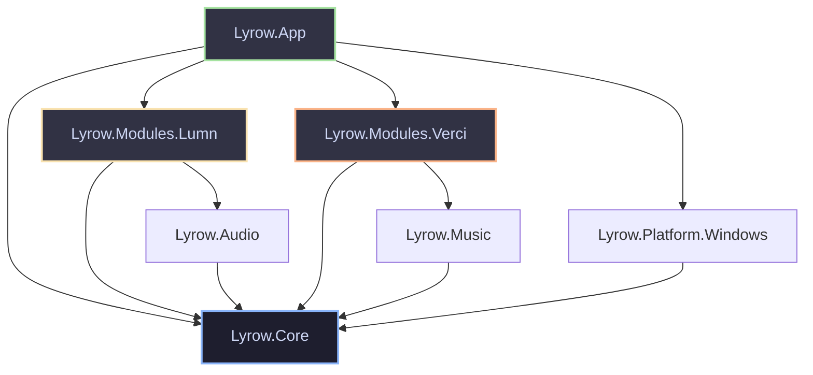
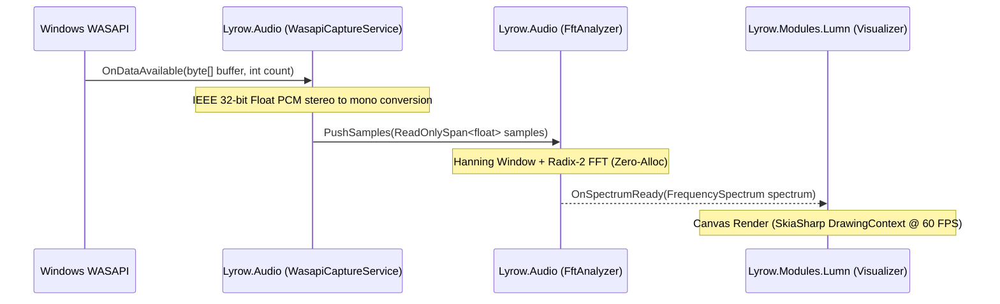
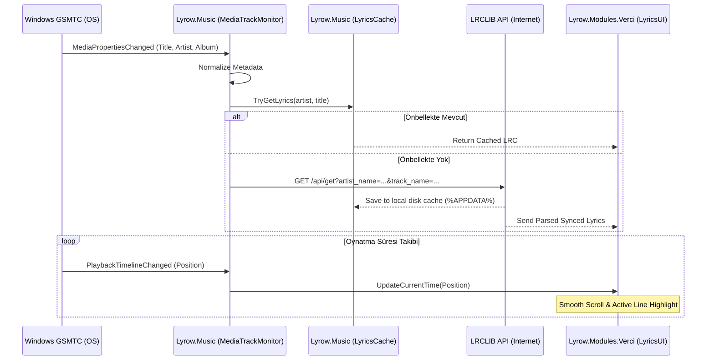

# Lyrow — Mimari Tasarım Belgesi (ARCHITECTURE.md)

Bu belge, **Lyrow** Windows masaüstü uygulamasının yüksek seviyeli mimarisini, bileşen sınırlarını, teknoloji seçimlerini ve temel tasarım kararlarını açıklar.

---

## 1. Proje Özeti ve Temel Ürün Kuralları

**Lyrow**, iki bağımsız multimedya modülünü tek bir zarif Windows masaüstü uygulamasında birleştiren modern bir C#/.NET masaüstü yazılımıdır:

- **Lumn:** Sistem sesini gerçek zamanlı analiz ederek müziğe tepki veren ışık efektleri ve masaüstü görselleştirmeleri sunan modül.
- **Verci:** Müzik metadata bilgilerini (şarkı, sanatçı, albüm kapağı) ve senkronize şarkı sözlerini (LRC) yüzen overlay veya tam ekran pencerelerde sunan modül.

### Temel Ürün İlkeleri (Architectural Invariants)
1. **Bağımsızlık (Loose Coupling):** Lumn, Verci olmadan; Verci, Lumn olmadan çalışabilir. İki modül birbirine doğrudan referans veremez.
2. **Eşzamanlılık:** İki modül aynı anda çalışabilir ve kullanıcı tercihine göre görsel olarak bütünleşebilir.
3. **Tek Süreç İlkesi:** Modüller için ayrı arka plan süreçleri (processes) açılmaz; tüm modüller tek bir ana uygulama süreci içinde bağımsız servisler olarak yönetilir.
4. **Hata İzolasyonu:** Bir modülde meydana gelen çökme veya istisna diğer modülü veya ana pencereyi durdurmamalıdır.
5. **Sıfır Arka Plan Yükü (Zero Inactive Overhead):** Kapatılan veya duraklatılan bir modül CPU veya GPU tüketmeye devam etmemelidir; tüm timer, loopback capture ve render döngüleri derhal durdurulur ve kaynaklar serbest bırakılır.
6. **Kullanıcı Ayarlarının Korunumu:** Modül konfigürasyonları, pencere koordinatları ve tercihler `%APPDATA%\Lyrow\settings.json` altında kalıcıdır.

---

## 2. Teknoloji Seçimleri ve Doğrulama Sonuçları

| Alan | Seçilen Teknoloji / Kütüphane | Lisans | Gerekçe ve Teknik Kanıt |
| :--- | :--- | :--- | :--- |
| **Çatı (Framework)** | **.NET 9 (Hedef: .NET 10 LTS)** | MIT | Geliştirme ortamında .NET 9.0.318 SDK kurulu olduğu tespit edilmiştir. .NET 10 genel erişime açıldığında doğrudan güncellenebilecek şekilde `net9.0` temel alınmıştır. |
| **UI Çerçevesi** | **Avalonia UI (v11.2+ / v12.1.4)** | MIT | XAML tabanlı, GPU hızlandırmalı (SkiaSharp), Windows şeffaflık (`WindowTransparencyLevel.Transparent`), çoklu ekran ve cross-platform genişleme desteği. |
| **Ses Yakalama** | **Windows Core Audio / WASAPI Loopback (`NAudio.Wasapi`)** | MIT | Sistem ses çıkışını sürücü seviyesinde asenkron yakalamak için endüstri standardı. Ses çalınırken sıfır gecikmeli PCM veri akışı sağlar. |
| **Ses Analizi** | **Hafif Sıfır-Tahsisli (Zero-Alloc) FFT Motoru** | Özel / MIT | Avalonia render döngüsünde GC baskısı yaratmamak için `ArrayPool<float>` veya sabit stack buffer kullanan özel Cooley-Tukey FFT algoritması. |
| **Müzik Metadata** | **Windows GSMTC (`GlobalSystemMediaTransportControls`)** | Microsoft WinRT | Spotify, Apple Music, YouTube, Chrome, Edge vb. tüm medya oynatıcıları ek API anahtarı veya kimlik doğrulama gerektirmeden yerel OS servisinden dinler. |
| **Şarkı Sözü Servisi** | **LRCLIB REST API (`https://lrclib.net`)** | Açık Kaynak / Ücretsiz | Senkronize (synced LRC) şarkı sözleri için açık, ücretsiz ve API anahtarı istemeyen güvenilir sağlayıcı. |
| **Pencere Overlay** | **Win32 P/Invoke (`WS_EX_TRANSPARENT`, `WS_EX_LAYERED`)** | N/A | Avalonia penceresinin arkasındaki oyun ve pencerelere tıklamaların geçmesini (click-through) sağlamak için Windows User32 API entegrasyonu. |
| **Veri & Güvenlik** | **`System.Text.Json` + Windows DPAPI (`ProtectedData`)** | Dahili .NET | Hızlı, düşük bellekli JSON serileştirme ve kullanıcıya özel DPAPI şifrelemesi. |
| **Test Çatısı** | **xUnit + FluentAssertions** | Apache-2.0 | .NET ekosisteminde standart birim ve entegrasyon test altyapısı. |

---

## 3. Önerilen Proje Yapısı ve Sorumluluk Dağılımı

Gereksiz katman karmaşasını önlemek ve her birimin net bir sorumluluğa (Single Responsibility Principle) sahip olmasını sağlamak adına aşağıdaki sadeleştirilmiş mimari yapı belirlenmiştir:

```
Lyrow/
├── src/
│   ├── Lyrow.App/                 # Avalonia UI Host, DI başlatma, Tray Icon, Pencereler
│   ├── Lyrow.Core/                # Temel arayüzler, Modül yaşam döngüsü, EventBus, Modeller, Ayarlar
│   ├── Lyrow.Audio/               # WASAPI Loopback yakalama, FFT matematiksel analiz motoru
│   ├── Lyrow.Music/               # GSMTC medya dinleme, LRCLIB istemcisi, LRC parser ve önbellek
│   ├── Lyrow.Modules.Lumn/        # Lumn görselleştirme motoru ve ışık efekt kontrolleri
│   ├── Lyrow.Modules.Verci/       # Verci şarkı sözü penceresi, zamanlama ve akış kontrolleri
│   └── Lyrow.Platform.Windows/    # Windows'a özgü Win32 P/Invoke (Click-through, DWM, GSMTC adaptörleri)
├── tests/
│   ├── Lyrow.Core.Tests/          # Modül yaşam döngüsü ve ayar testleri
│   ├── Lyrow.Audio.Tests/         # FFT matematiksel doğruluk ve buffer testleri
│   └── Lyrow.Music.Tests/         # LRC ayrıştırma, zamanlama ve cache testleri
├── docs/                          # Proje mimarisi ve geliştirme planları
└── Lyrow.sln                      # Visual Studio / .NET Solution
```

### Proje Bağımlılık Grafiği



> **Önemli Kural:** `Lyrow.Modules.Lumn` ve `Lyrow.Modules.Verci` birbirine asla doğrudan bağımlı değildir. İki modül arasındaki koordinasyon (örneğin Verci'nin çalan şarkı temposunu veya durumunu yayınlaması), `Lyrow.Core` içindeki gevşek bağlı olay veri yolu (`IEventBus`) üzerinden sağlanır.

---

## 4. Modül Yaşam Döngüsü (Module Lifecycle)

Her iki modül de ortak bir `ILyrowModule` sözleşmesini uygular:

```csharp
namespace Lyrow.Core.Contracts;

public interface ILyrowModule : IAsyncDisposable
{
    string ModuleId { get; }
    string DisplayName { get; }
    ModuleState State { get; }

    Task InitializeAsync(CancellationToken cancellationToken = default);
    Task StartAsync(CancellationToken cancellationToken = default);
    Task StopAsync(CancellationToken cancellationToken = default);
}

public enum ModuleState
{
    Uninitialized,
    Initialized,
    Starting,
    Running,
    Stopping,
    Stopped,
    Faulted
}
```

### Yaşam Döngüsü İlkeleri:
1. **Kaynak Boşaltma:** `StopAsync` çağrıldığında modüle ait pencereler gizlenir veya kapatılır; arka plan timer'ları (`DispatcherTimer`), ses yakalama (`WasapiLoopbackCapture`) ve HTTP bağlantıları anında durdurulur.
2. **Hata Yakalama (Fault Containment):** Modül içinde yakalanmayan bir hata oluştuğunda modül `Faulted` durumuna geçer ve `ModuleFaultedEvent` tetiklenir. Diğer modül ve ana uygulama çalışmaya devam eder.

---

## 5. Ses Yakalama ve Analiz Akışı (Audio Pipeline)

Lumn modülünün ses işleme mimarisi aşağıdaki adımlarla işler:



### Kritik Ses Riskleri ve Çözümleri:
- **Cihaz Kaybı / Değişikliği (`AUDCLNT_E_DEVICE_INVALIDATED`):** Kullanıcı kulaklık taktığında veya varsayılan ses aygıtını değiştirdiğinde WASAPI hata döndürür. `AudioCaptureService`, Windows `IMMNotificationClient` ile varsayılan aygıt değişikliğini yakalar; akışı güvenli bir şekilde durdurur ve yeni aygıt üzerinden 500 ms içinde otomatik olarak yeniden başlatır.
- **Sessizlik Durumu:** Sistemde ses çalınmıyorsa WASAPI sıfır değerli buffer'lar üretir. Analiz motoru enerji seviyesi eşik değerinin altındaysa FFT hesaplamasını ve render döngüsünü askıya alarak CPU tüketimini %0'a çeker.

---

## 6. Müzik Metadata ve Şarkı Sözü Akışı (Music & Lyrics Pipeline)

Verci modülünün bilgi akışı:



---

## 7. Görsel Entegrasyon ve Overlay Mimarisi

- **Click-Through Özelliği:** Kullanıcı şarkı sözlerinin veya ışık efektlerinin üzerinden oyun oynamak veya masaüstünde çalışmak istediğinde "Tıklama Geçirgenliği (Click-Through)" modunu açabilir.
- **Win32 Uygulaması:**
  ```csharp
  // Lyrow.Platform.Windows:
  var hwnd = window.TryGetPlatformHandle()?.Handle;
  if (hwnd.HasValue)
  {
      int exStyle = User32.GetWindowLong(hwnd.Value, GWL_EXSTYLE);
      User32.SetWindowLong(hwnd.Value, GWL_EXSTYLE, exStyle | WS_EX_TRANSPARENT | WS_EX_LAYERED);
  }
  ```
- **Tam Ekran Oyun Kısıtı:** Windows DWM (Desktop Window Manager) mimarisinde, "Exclusive Fullscreen" modundaki DirectX/Vulkan oyunları masaüstü katmanlarını devre dışı bırakır. Overlay'ler yalnızca "Borderless Windowed" veya masaüstü pencerelerinde görüntülenebilir. Bu durum dokümantasyon ve kullanıcı arayüzünde bilgilendirme olarak sunulmalıdır.
- **DPI ve Çoklu Monitör:** Avalonia'nın `Screens` API'si üzerinden pencere hedef monitörün `WorkingArea` ve `Scaling` oranlarına göre dinamik konumlandırılır. Monitör takılıp çıkarıldığında pencere koordinatları otomatik olarak düzeltilir.

---

## 8. Tema ve Ayarlar Mimarisi

- **Açık / Koyu / Sistem Teması:** Avalonia'nın `RequestedThemeVariant` özelliği kullanılarak `ThemeVariant.Dark`, `ThemeVariant.Light` veya `ThemeVariant.Default` (sistem temasını izleme) desteklenir.
- **Ayarlar Depolama:** `%APPDATA%\Lyrow\settings.json` dosyasında `System.Text.Json` formatında tutulur. Atomic write (önce geçici dosyaya yazıp sonra `File.Replace` yapma) uygulanarak elektrik kesintisi veya ani kapanmalarda bozulma önlenir.

---

## 9. Güvenlik, Gizlilik ve Lisans Uyumluluğu

1. **Ağ Gizliliği:** Lyrow yalnızca şarkı sözlerini çekmek amacıyla LRCLIB REST API'sine istek atar. Herhangi bir kullanıcı telemetrisi, ses kaydı veya kişisel veri harici sunuculara iletilmez.
2. **Lisanslar:** Kullanılan tüm kütüphaneler (Avalonia, NAudio, xUnit, FluentAssertions) ticari ve açık kaynak uyumlu MIT / Apache 2.0 lisanslarına sahiptir.
3. **Şarkı Sözü Telif Hakları:** LRCLIB topluluk tabanlı bir sağlayıcıdır. Kullanıcıların yerel `.lrc` dosyalarını yüklemelerine de imkan tanınarak yasal riskler en aza indirilir.
