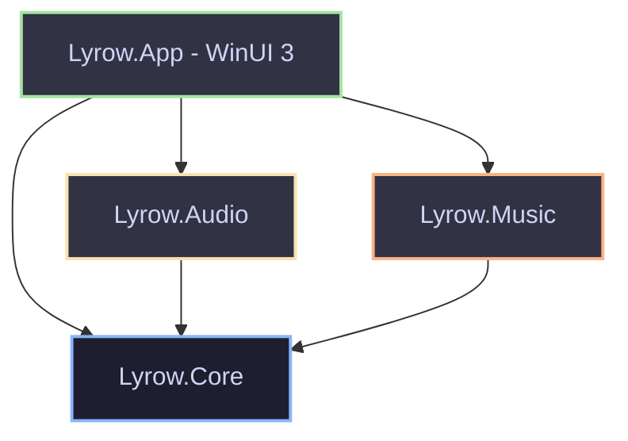
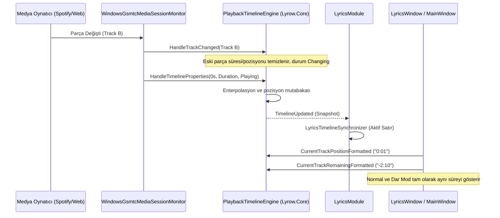

# Lyrow — Mimari Tasarım Belgesi (ARCHITECTURE.md)

Bu belge, **Lyrow** Windows masaüstü uygulamasının yüksek seviyeli mimarisini, bileşen sınırlarını, teknoloji seçimlerini ve temel tasarım kararlarını açıklar.

---

## 1. Proje Özeti ve Temel Ürün İlkeleri

**Lyrow**, Windows 10 (19041+) ve Windows 11 üzerinde müzik dinleme deneyimini görsel bir atmosfere dönüştüren, **WinUI 3 ve Windows App SDK** mimarisiyle geliştirilmiş modern bir C#/.NET masaüstü yazılımıdır.

Uygulama iki temel modülü tek bir zarif süreç içinde birleştirir:

- **Glow:** Sistem ses çıkışını (WASAPI Loopback) gerçek zamanlı analiz ederek müziğin ritmine ve albüm kapağının renk enerjisine göre ekranın dört kenarına (Top, Bottom, Left, Right) yayılan ortam ışıklandırması sunan modül.
- **Lyrics:** Windows GSMTC üzerinden çalan medyayı dinleyen, LRCLIB üzerinden senkronize şarkı sözlerini çeken, **Normal Mod** ve **Dar Mod (Compact Player — 352×148 px)** görünümleriyle dikey merkezlenen 60 FPS akıcı karaoke söz deneyimi sunan modül.

### Temel Mimari İlkeler (Architectural Invariants)
1. **Gevşek Bağlılık (Loose Coupling):** `Lyrow.Audio` ve `Lyrow.Music` modülleri birbirine doğrudan referans veremez. İki modül arasındaki koordinasyon `Lyrow.Core` içindeki sözleşmeler (`Contracts`) ve olay veri yolu (`IEventBus`) üzerinden sağlanır.
2. **Merkezi Zaman Motoru:** Tüm zamanlama, süre sayacı (`0:45`), kalan süre (`-2:15`), seek ve enterpolasyon işlemleri tek bir yetkili motor olan `IPlaybackTimelineEngine` tarafından yönetilir.
3. **Tek Süreç İlkesi:** Modüller için ayrı arka plan süreçleri açılmaz; tüm modüller tek bir ana uygulama süreci (`Lyrow.App.exe`) içinde bağımsız servisler olarak yönetilir.
4. **Hata İzolasyonu:** Bir modülde veya ağ isteğinde meydana gelen istisna ana uygulamayı durduramaz; modül kendi içinde hata durumunu yönetir ve otomatik toparlanır.
5. **Sıfır Etkisiz Yük (Zero Inactive Overhead):** Kapatılan veya duraklatılan bir modül CPU veya GPU tüketmeye devam etmez; WASAPI loopback capture, FFT hesaplamaları ve UI timer'ları durdurulur.
6. **Kalıcı Ayarlar:** Modül yapılandırmaları ve tercihler `%APPDATA%\Lyrow\settings.json` altında atomik olarak saklanır.

---

## 2. Teknoloji Seçimleri

| Alan | Seçilen Teknoloji / Kütüphane | Lisans | Gerekçe ve Teknik Kanıt |
| :--- | :--- | :--- | :--- |
| **Çatı (Framework)** | **.NET 10 LTS (C# 13)** | MIT | Yüksek performanslı bellek yönetimi, Span/Memory optimizasyonları ve Windows x64 yerel desteği. |
| **UI Çerçevesi** | **WinUI 3 / Windows App SDK 1.8** | MIT | Yerel Windows 11 Fluent Design, donanım hızlandırmalı DirectX/Composition katmanı, şeffaf pencereler ve Neumorphism gölgelendirmesi. |
| **Ses Yakalama** | **Windows Core Audio / WASAPI Loopback (`NAudio.Wasapi`)** | MIT | Sistem ses çıkışını sürücü seviyesinde sıfır gecikmeli PCM veri akışı olarak yakalar. |
| **Ses Analizi** | **Hafif Sıfır-Tahsisli (Zero-Alloc) FFT & Spectral Flux** | Özel / MIT | 5 frekans bandı (Sub-Bass, Bass, Low-Mid, Mid, Treble) ve gerçek zamanlı vuruş algılama; GC baskısı yaratmayan bellek havuzları (`ArrayPool<float>`). |
| **Müzik Metadata** | **Windows GSMTC (`GlobalSystemMediaTransportControls`)** | WinRT | Spotify Desktop, Apple Music, YouTube Music Web gibi tüm modern oynatıcıları ek API anahtarı gerekmeden yerel işletim sistemi servisinden dinler. |
| **Zamanlama Motoru** | **`PlaybackTimelineEngine` (`Lyrow.Core`)** | MIT | Şarkı başına izole elapsed/remaining süresi sağlayan, kümülatif süre hatalarını ve parça geçiş gecikmelerini önleyen merkezi motor. |
| **Şarkı Sözü Servisi** | **LRCLIB REST API (`https://lrclib.net`)** | Açık Kaynak / Ücretsiz | Senkronize şarkı sözleri için ücretsiz, API anahtarı istemeyen güvenilir topluluk sağlayıcısı; yerel disk önbelleği desteği. |
| **Pencere Overlay** | **Win32 P/Invoke (`WS_EX_TRANSPARENT`, `WS_EX_LAYERED`)** | N/A | Ambient Glow kenarlıklarının arka plandaki pencerelere ve oyunlara tıklama geçirmesini (click-through) sağlar. |
| **Veri & Güvenlik** | **`System.Text.Json` + Windows DPAPI** | Dahili .NET | Hızlı, düşük bellekli JSON serileştirme ve kullanıcıya özel DPAPI şifrelemesi. |
| **Test Çatısı** | **xUnit + FluentAssertions** | Apache-2.0 | 635 birim ve entegrasyon testini kapsayan otomatik kalite güvencesi. |

---

## 3. Proje Yapısı ve Sorumluluk Dağılımı

```
Lyrow/
├── src/
│   ├── Lyrow.App/                 # WinUI 3 arayüzü, MainWindow, LyricsWindow, GlowOverlayWindow, ViewModels, System Tray
│   ├── Lyrow.Core/                # Temel arayüzler, IPlaybackTimelineEngine, PlaybackTimelineEngine, EventBus, Ayarlar, Modeller
│   ├── Lyrow.Audio/               # WASAPI Loopback yakalama, FFT matematik motoru, Spectral Flux beat algılama, Audio Routing
│   └── Lyrow.Music/               # GSMTC medya dinleme, MediaMetadataNormalizer, LRCLIB istemcisi, LRC parser ve önbellek
├── tests/
│   ├── Lyrow.Core.Tests/          # Modül yaşam döngüsü ve ayar testleri (59 test)
│   ├── Lyrow.Audio.Tests/         # FFT matematiksel doğruluk ve buffer testleri (53 test)
│   ├── Lyrow.Music.Tests/         # GSMTC zaman çizelgesi, LRC ayrıştırma ve parça geçiş testleri (120 test)
│   └── Lyrow.App.Tests/           # WinUI 3 ViewModelleri, Dar Mod hesaplamaları, Timeline regresyon testleri (403 test)
├── docs/                          # Proje mimarisi ve sürüm notları
└── Lyrow.sln                      # .NET Solution
```

### Proje Bağımlılık Grafiği



> **Önemli Kural:** `Lyrow.Audio` ve `Lyrow.Music` birbirine asla doğrudan bağımlı değildir.

---

## 4. Merkezi Playback Timeline Mimarisi

v3.7 sürümüyle hayata geçirilen `PlaybackTimelineEngine` mimarisi, oynatma zaman çizelgesini tek bir otoriteye bağlar:



---

## 5. Görsel Entegrasyon ve Güvenlik

1. **Click-Through (Tıklama Geçirgenliği):** Ambient Glow pencereleri `WS_EX_TRANSPARENT | WS_EX_LAYERED` Win32 genişletilmiş pencere stilleriyle donatılmıştır; arkasındaki tam ekran veya pencereli oyunlara/uygulamalara tıklamalar kesintisiz iletilir.
2. **Ağ Gizliliği:** Yalnızca şarkı sözü aramak için LRCLIB REST API'sine istek yapılır. Hiçbir telemetri, kullanıcı verisi veya ses içeriği harici sunuculara iletilmez.
3. **Lisans Uyumluluğu:** Tüm bağımlılıklar açık kaynak ve ticari kullanıma uygun MIT/Apache 2.0 lisanslıdır.
