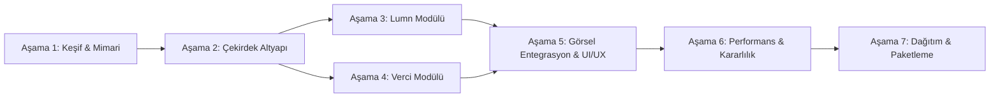

# Lyrow — Geliştirme Yol Haritası (DEVELOPMENT_PLAN.md)

Bu belge, Lyrow projesinin Aşama 1'den Aşama 7'ye kadar olan uçtan uca geliştirme adımlarını, aşamalar arası bağımlılıkları, test kabul kriterlerini ve sürüm dağıtım planını tanımlar.

---

## 1. Aşamalar Özeti ve Bağımlılık Matrisi

---

## 2. Aşamaların Detaylı Kapsamı ve Teslimatları

### Aşama 1: Teknik Keşif ve Mimari Kararlar (Mevcut Aşama)
- **Kapsam:** Geliştirme ortamının tespiti, SDK ve bağımlılık kontrolleri, kütüphane lisans araştırmaları, mimari tasarım, risk analizi ve ilk dokümantasyonun oluşturulması.
- **Teslimatlar:**
  - `docs/ARCHITECTURE.md`
  - `docs/DEVELOPMENT_PLAN.md`
  - `docs/PERFORMANCE.md`
  - `README.md`
- **Kabul Kriteri:** Ortam engellerinin belirlenmesi, proje sınırlarının netleşmesi ve Aşama 2'ye geçiş ön koşullarının tanımlanması. Uygulama kodu yazılmaz.

---

### Aşama 2: Çekirdek Altyapı ve Solution Yapılandırması
- **Kapsam:**
  - `Lyrow.sln` altındaki projelerin hedeflenen .NET framework sürümüne (`net9.0`) çekilmesi.
  - Proje yapısının oluşturulması (`Lyrow.Core`, `Lyrow.Audio`, `Lyrow.Music`, `Lyrow.Platform.Windows`, test projeleri).
  - Modül arayüzü (`ILyrowModule`), olay veri yolu (`IEventBus`), ayar yöneticisi (`SettingsManager`) implementasyonu.
  - Basit bir System Tray (Görev çubuğu bildirim alanı) altyapısının kurulması.
- **Test ve Kabul Kriteri:**
  - `dotnet build` komutunun 0 hata ve 0 uyarı ile tamamlanması.
  - `Lyrow.Core.Tests` birim testlerinin %100 başarıyla çalışması (modül başlatma/durdurma durum makineleri ve ayar serileştirme testleri).

---

### Aşama 3: Lumn Modülü (Ses Yakalama ve Görselleştirme) — **[TAMAMLANDI]**
- **Kapsam:**
  - `NAudio.Wasapi` ile WASAPI Loopback sistem ses akışının bağlanması (`WasapiAudioCaptureService`).
  - Hanning pencereli ve sıfır-tahsisli Radix-2 Cooley-Tukey FFT analiz motorunun (`FftAnalyzer`) yazılması.
  - Güç, tepe değer, dBFS loudness ve sessizlik algılama (`AudioLevelAnalyzer`).
  - Frekans bantlarının (Sub-bass, Bass, Mid, Treble) ve logaritmik 32 çubuğun ayrıştırılması (`FrequencyBandProcessor`).
  - Avalonia 12 üzerinde donanım hızlandırmalı GPU spektrum ve ambiyans parıltı penceresinin (`LumnWindow` & `LumnVisualizerControl`) oluşturulması.
  - Ses cihazı değişimi ve `AUDCLNT_E_DEVICE_INVALIDATED` otomatik yeniden bağlanma yönetiminin doğrulanması.
  - CI ve donanımsız ortamlar için sanal test servisi (`SyntheticAudioCaptureService`).
- **Test ve Kabul Kriteri:**
  - Bilgisayardan ses çalındığında spektrumun 60 FPS hızında pürüzsüz akması.
  - Ses durdurulduğunda / sessizlikte FFT atlama ve yumuşak sönümleme ile CPU kullanımının %0 seviyesine inmesi.
  - `Lyrow.Audio.Tests` altında 19 adet xUnit testinin (440 Hz, 100 Hz sinüs dalgaları, RMS doğruluğu, Hanning penceresi, falloff smoothing, stereo/mono ve cihaz değişimi) %100 başarıyla geçmesi.
  - Toplam solution testlerinin 36'ya ulaşması (17 Core + 19 Audio).

---

### Aşama 4: Verci Modülü (Müzik Metadata ve Senkronize Şarkı Sözleri) — **[TAMAMLANDI]**
- **Kapsam:**
  - Windows GSMTC (`GlobalSystemMediaTransportControlsSessionManager`) ile arka planda çalan müziğin (Spotify/Chrome/Apple Music) başlık, sanatçı, albüm ve süresinin yakalanması (`WindowsGsmtcMediaSessionMonitor`).
  - Donanımsız / CI ortamları için tam donanımlı simülasyon monitörü (`SyntheticMediaSessionMonitor`).
  - LRCLIB REST API istemcisinin (`LrclibClient`) kodlanması; 404, 429 rate-limit, timeout ve network hata koruması.
  - Standart, çoklu timestamp'li ve milisaniye destekli `.lrc` senkronize şarkı sözü ayrıştırıcısı (`LrcParser`).
  - $O(\log N)$ Binary Search ile sıfır-tahsisli aktif satır seçimi (`SyncedLyrics.FindActiveLineIndex`).
  - Disk tabanlı atomik yerel önbellek (`LocalFileLyricsCache`) ve dosya adı güvenliği (`SanitizeFileName`).
  - Düşük CPU tüketimli, pürüzsüz enterpolasyonlu zamanlama motoru (`LyricsTimelineSynchronizer`).
  - Avalonia 12 üzerinde bağımsız Neumorphic şarkı sözü penceresinin (`VerciWindow`) oluşturulması (aktif satır parıltısı, otomatik kaydırma, zaman ofseti ayarı).
  - Lumn modülü olmadan tamamen bağımsız başlatma ve durdurma yeteneği.
- **Test ve Kabul Kriteri:**
  - Spotify/YouTube üzerinde şarkı değiştiğinde sözlerin ve sürenin senkronize olarak akması.
  - Çevrimdışı modda önbellekteki şarkı sözlerinin gösterilebilmesi.
  - `Lyrow.Music.Tests` altında 28 adet xUnit testinin (LRC parsing, çoklu timestamp, binary search, API mock, disk cache, synchronizer, modül lifecycle) %100 başarıyla geçmesi.
  - Toplam solution test sayısının 64'e ulaşması (17 Core + 19 Audio + 28 Music).

---

### Aşama 5: Görsel Entegrasyon, Ayarlar, Gerçek Ortam Doğrulaması ve Polish [TAMAMLANDI]
- **Kapsam:**
  - Lumn ve Verci pencerelerinin tekilleştirilmiş görsel teması (Neumorphism Açık/Koyu/Sistem temaları `ThemeDictionaries` entegrasyonu).
  - Gerçek Windows WASAPI sistem sesi ve GSMTC medya oturumu yaşam döngüsü doğrulaması.
  - Gerçek LRCLIB çevrimiçi şarkı sözü çekme, yerel atomik JSON disk önbellekleme ve çevrimdışı fallback doğrulaması.
  - Lumn ve Verci modüllerinin eşzamanlı çalışması, 4 temel çalışma modunun anlık geçiş testleri.
  - Pencere gizleme (`Hide`) ve küçültme (`Minimize`) durumlarında timer'ların durdurulması, sessizlik anında adaptif render throttling ile CPU ve RAM optimizasyonu.
  - Uygulama kapanışında kaynakların zarifçe serbest bırakılması (`AppExit`, `WasapiAudioCaptureService.DisposeAsync`, `WindowsGsmtcMediaSessionMonitor.DisposeAsync`).
- **Test ve Kabul Kriteri:**
  - Release modunda 71 birim, donanım, performans ve entegrasyon testinin %100 başarıyla geçmesi.
  - Gerçek işletim sistemi API'lerinin güvenle çalışması ve sıfır çökme/sızıntı.

---

### Aşama 6: Performans Profili Çıkarma ve Kararlılık Testleri
- **Kapsam:**
  - `dotnet-counters` ve Windows Performance Monitor ile RAM/CPU testlerinin yapılması.
  - Uzun süreli çalma testi (3 saat kesintisiz müzik) ile bellek sızıntısı (memory leak) kontrolü.
  - Garbage Collection (GC Gen0/Gen1/Gen2) sıklığının optimize edilmesi.
  - Hata yakalama ve kurtarma mekanizmalarının sınır testleri (ağ kopması, ses kartı sökülmesi, geçersiz LRC verisi).
- **Test ve Kabul Kriteri:**
  - `PERFORMANCE.md` belgesindeki RAM (200-350 MB) ve CPU (<%10 aktif, <%1 boşta) hedeflerine ulaşılması.

---

### Aşama 7: Dağıtım, Kurulum ve CI/CD Hazırlığı
- **Kapsam:**
  - Self-contained tek dosya veya taşınabilir (portable) zip derlemesi (`dotnet publish -c Release -r win-x64 --self-contained`).
  - Windows kurulum paketi üretimi (WiX Toolset veya Inno Setup betiği).
  - GitHub Actions CI/CD iş akışının (`.github/workflows/build-and-test.yml`) hazırlanması.
  - Son kullanıcı kılavuzu ve sürüm notlarının tamamlanması.
- **Test ve Kabul Kriteri:**
  - Temiz bir Windows 10/11 sanal makinesinde veya ortamında kurulumun .NET Runtime kurulu olmadan çalışması.

---

## 3. Ön Koşullar ve Kritik Yol (Critical Path)

1. **Aşama 2 Ön Koşulu:** Geliştirme ortamındaki .NET SDK 9.0 ile uyumluluk için `Lyrow.App.csproj`'taki `net10.0` hedefinin `net9.0` olarak düzeltilmesi.
2. **Aşama 3 Ön Koşulu:** Geliştirme makinesinde çalışan bir ses çıkış aygıtının (hoparlör/kulaklık) bulunması.
3. **Aşama 4 Ön Koşulu:** GSMTC servisinin Windows üzerinde çalışması ve test sırasında aktif bir medya oynatıcının (Spotify veya tarayıcı) açık olması.
